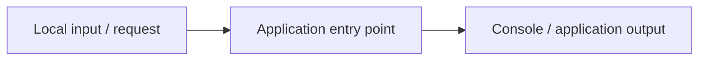

# Computer Resource Dashboard

A local Streamlit dashboard for CPU, memory, storage, network, temperature, and optional NVIDIA GPU utilization.

[Research notes](docs/RESEARCH.md) · [Architecture](docs/ARCHITECTURE.md) · [Execution record](docs/RESULTS.md) · [Project site](docs/index.html)

---

## Research context

How usable is a compact dashboard for correlating local CPU, memory, storage, and network signals?

The repository provides an inspectable implementation of **local resource dashboard**. It is an exploratory engineering project; broader effectiveness and practical deployment require further study.

## Implemented capabilities

- Local resource dashboard

## Architecture



The diagram is a simplified view of the supplied implementation. Detailed modules and interface assumptions are in [architecture notes](docs/ARCHITECTURE.md).

## Run locally

**Environment:** Python 3.11+ is the documented baseline. Install optional services or hardware drivers when required. Dependencies: streamlit, psutil, pynvml.

```bash
python -m venv .venv
source .venv/bin/activate       # Windows: .venv\Scripts\activate
python -m pip install -r requirements.txt
```

Run the following commands from the repository root:

```bash
streamlit run src/app.py
```

**Input:** local configuration / interactive input

## Results

**Not executed in this environment.** This project requires an interactive Streamlit application and runtime dependencies. No image or numerical result is presented as execution evidence. See [original instructions](docs/ORIGINAL_README.md) for local setup.

## Source structure

- Refer to the source tree.

Documentation is in [`docs/`](docs/). Bundled inputs remain in their original folders. The original project instructions are archived in [`docs/ORIGINAL_README.md`](docs/ORIGINAL_README.md).

## Limits and next research steps

- Results shown here are from local bundled inputs; they are not published research findings or evidence of external deployment.
- Validate domain assumptions and compare against a documented baseline before making performance or reliability claims.
- Extend testing to larger, independently sourced datasets and report reproducibility, failures and relevant ethical risks.

For the methodology and evaluation design, see [the research brief](docs/RESEARCH.md).

## License

See [`LICENSE`](LICENSE). No affiliation, patent, publication, production deployment or independent endorsement is implied.
