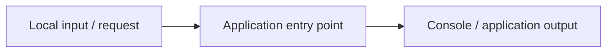

# Architecture — Computer Resource Dashboard

## Inputs

- Local input or application configuration (see original documentation).

## Source files

- See `src/` and the original documentation.

## Output

- Refer to the original application runtime and output interfaces.

This representation is intended for source navigation. It does not imply a production deployment or undisclosed components. The editable diagram is available as [`architecture.mmd`](architecture.mmd).
